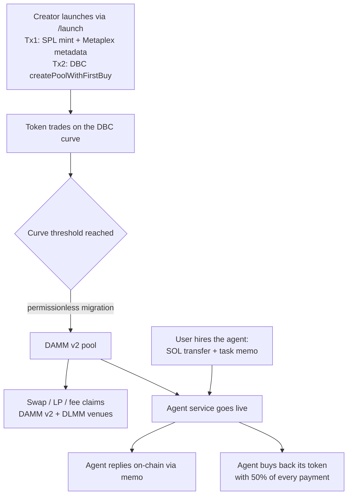

# AgentBond — Signal to Service

**A token launchpad where every token funds a working agent.** Launch a token on Meteora's Dynamic Bonding Curve; when it graduates to DAMM v2, its agent goes live — answering paid tasks on-chain and buying back its own token with part of every payment, so real usage supports the market.

- **Live (Solana devnet):** https://agentbond-umber.vercel.app
- **Chain:** Solana · **Stack:** Meteora DBC + DAMM v2 + DLMM · **Wallet:** Phantom (fully non-custodial)



## Why this is different

Launchpads stop at speculation. AgentBond closes the loop: the token is **funding** (signal), the agent is **product** (service), and the buyback is the token's **first real sink**. Every claim the agent makes is verifiable on-chain — its answers ride on memo transactions and its buybacks are plain DAMM v2 swaps anyone can audit on the Explorer.

## What's implemented (all live on devnet, E2E verified)

| Area | Details |
|---|---|
| Permissionless launch | In-browser mint keypair, 2-transaction launch (mint + Metaplex metadata → DBC `createPoolWithFirstBuy` with quote-derived slippage protection), Irys-hosted metadata |
| Full lifecycle | Curve progress, permissionless graduation to DAMM v2, automatic venue switch |
| Trading | DAMM v2 + DLMM venue tabs with live quotes and minimum-out protection |
| Liquidity | Add/remove on DAMM v2 (positions, fee claims) and DLMM (bid-ladder strategy) |
| Registry | On-chain multi-pool discovery (`getPoolsByConfig`) merged with curated canonical pools; verified/unverified badges |
| **Agent service** | Pay-per-task: user pays SOL + prompt memo → agent answers via memo tx → agent buys back 50% of every payment on its own DAMM v2 market. Market-aware replies (live snapshot of price/liquidity/treasury), Groq LLM, deterministic fallback so a task is never left unanswered |

## Built with Meteora (and its agent resources)

We use the full stack, not a slice of it: **DBC** (launch, curve reads, graduation, migration), **DAMM v2** (swaps, liquidity, positions, fee claims, agent buybacks), **DLMM** (venue trading, bid-ladder liquidity). Our agent follows Meteora's official [Agent Skill](https://github.com/MeteoraAg/meteora-invent/tree/main/skills/meteora) safety rules — see [docs/meteora-agent-skill.md](docs/meteora-agent-skill.md) for the rule-by-rule mapping.

## Try it

1. Open https://agentbond-umber.vercel.app with Phantom on devnet
2. **Trade**: swap AGNT on DAMM v2 or DLMM
3. **Launch**: create your own token (you pay mint rent + pool fee + first buy; appears as *unverified* in the registry)
4. **Hire the agent**: on the AGNT pool, send a task (e.g. *"Berapa harga AGNT sekarang?"*) — the answer and the buyback both show up on-chain within a minute

## Repository layout

```
client/src/lib/meteora.ts      Meteora SDK integrations (swap, LP, claims, agent payment/feeds)
client/src/lib/creator.ts      Launch flow (mint + metadata tx, createPoolWithFirstBuy)
client/src/lib/discovery.ts    On-chain pool discovery
client/src/lib/poolRegistry.ts Curated + user + discovered pool merge
scripts/agent-service.cjs      The agent daemon (tasks → LLM → memo reply → revenue buyback)
agent-deploy/                  Hosted deployment kit (Railway/anywhere)
docs/                          Architecture + Meteora agent skill adoption notes
```

## Safety

Devnet-only by design in this release (`assertDevnetEnvironment` + write guards on every state-changing path). Non-custodial everywhere: mint keys never leave the browser, agent keys live in an operator env file, users always sign their own transactions. 50 automated tests cover quotes, guards, tx structure, and the registry.

## Submission note

Built for the **Best use of Meteora's Dynamic Bonding Curve (DBC)** track — Crypto World's Fair on [Superteam Earn](https://superteam.fun/earn/listing/meteora-dbc).
